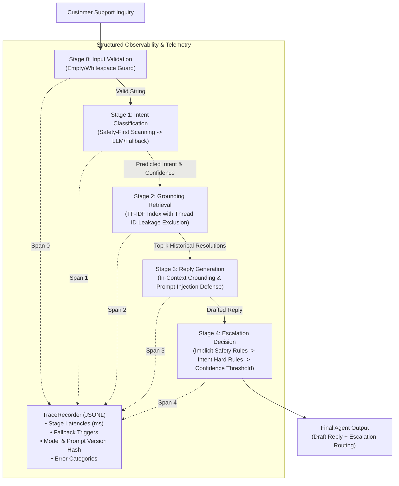

# TraceGuard — AI Agent Evaluation, Tracing & Regression Testing

> **Subtitle:** A safety-first customer support AI agent with reproducible evaluations, structured traces, and automated regression tests.

[](https://github.com/Ravibbk/uber_agent_project/actions/workflows/ci.yml)


---
---

## 1. Project Overview & Problem Statement

Production customer support AI agents present significant engineering and safety risks:
1. **Silent Failures & Misrouting:** Critical physical safety hazards (e.g., erratic driving, harassment, threats) can be misclassified as low-severity complaints (e.g., simple driver behavior feedback) and inappropriately auto-resolved without human agent escalation.
2. **Circular Evaluations & Data Leakage:** Many AI projects suffer from evaluation leakage: test labels generated by the same rules being evaluated, or retrieval indexes containing the test examples.
3. **Black-box Execution:** When an LLM agent fails, engineering teams lack span-level observability to identify whether the root cause was bad retrieval, ambiguous classification, LLM prompt regression, or flawed escalation thresholds.

**TraceGuard** solves these challenges by transforming a basic support agent into an **auditable, safety-first evaluation and observability platform**. It provides structured stage-by-stage tracing (JSONL), deterministic safety gates, an independently validated golden evaluation benchmark, baseline comparisons (trivial and keyword priors), and automated regression testing.

---

## 2. Architecture & Data Flow



---

## 3. Key Engineering Highlights & AI  Alignment

| Requirement | TraceGuard Implementation |
|---|---|
| **Python Engineering & Maintainability** | Modular architecture, strict type hints, Pydantic request/response schemas, zero unnecessary dependencies. |
| **AI Evaluation Harnesses** | Versioned benchmark harness (`eval/run_eval.py`) comparing agent against trivial and keyword baselines across accuracy, macro-F1, precision, and recall. |
| **Deterministic Checks + LLM Judge** | Deterministic safety gates and heuristic checks decoupled from LLM judge scoring (4 dimensions + hallucination flag). |
| **Prompt & Model Regression Detection** | Prompt hashing (`SHA-256`), model version tracking, and CI regression guardrail thresholds. |
| **Structured Tracing** | Span-based JSONL tracing (`src/tracing.py`) capturing run IDs, timestamps, stage latencies, fallbacks, model hashes, and error categories. |
| **Failure-to-Regression Workflow** | Documented real reproduction of Defect E (swerving driver misrouted to AUTO_HANDLE), fixed with hard safety scanner, and locked with automated pytest regression test. |
| **Data Leakage Controls** | Independent 35-case golden dataset with schema validation (`eval/golden_dataset.py`) and retrieval ID exclusion (`exclude_ids`). |
| **Automated Testing** | 115 passing Pytest tests covering unit, integration, safety regressions, and API endpoints without requiring paid API keys. |
| **Interactive Demo & API** | FastAPI REST service with interactive browser dashboard (`src/api.py`) featuring playground presets, decision inspector, and live span telemetry. |
| **CI / CD Pipeline** | GitHub Actions workflow (`.github/workflows/ci.yml`) running full test suite, dataset schema validation, deterministic evaluation, and regression checks. |

---

## 4. Evaluation Benchmark Results (v1.0-synthetic)

Evaluated against the versioned golden dataset (`eval/golden_v1.csv`, 33 validated test cases, dataset hash: `94ba23bf1d2f887d`):

### Intent Classification & Escalation Routing

| Model / Harness | Intent Accuracy | Intent Macro-F1 | Escalation Precision | Escalation Recall | Offline Deterministic? |
|---|---|---|---|---|---|
| **TraceGuard Agent** | **87.9%** (29/33) | **0.883** | **90.0%** | **69.2%** | **Yes (100%)** |
| **Simple Keyword Baseline** | 63.6% (21/33) | 0.682 | 100.0% | 38.5% | Yes (100%) |
| **Trivial Prior Baseline** | 18.2% (6/33) | 0.034 | 0.0% | 0.0% | Yes (100%) |

*Note: The trivial baseline uses a predeclared constant prior (`general_inquiry`) rather than leaking test set frequencies. Escalation positive class is `ESCALATE`.*

### Measured Reply Quality (Heuristic & LLM Judge Dimensions)
- **Mean Relevance (1-5):** 3.75
- **Mean Grounding (1-5):** 3.00
- **Mean Tone (1-5):** 4.00
- **Mean Actionability (1-5):** 5.00
- **Hallucination Rate:** 0.0% (deterministic dollar figure check)

---

## 5. Failure-to-Regression Walkthrough (The Swerving Driver Defect)

To demonstrate rigorous failure analysis and regression testing, here is a documented defect discovered in the legacy agent:

### 1. Incident Reproduction
- **Customer Message:** `"My driver was swerving across lanes"`
- **Expected Behavior:** High-priority safety incident; must route to `safety_concern` and `ESCALATE` to human safety personnel.
- **Observed Legacy Behavior:**
  - Classified as `driver_behavior` with 95% confidence.
  - Escalation logic only checked `if intent in ["safety_concern", ...]`.
  - Result: Marked as `AUTO_HANDLE`! An erratic driving hazard was left to an automated bot reply.

### 2. Root Cause Analysis
Intent classification and escalation rules had an implicit coupling vulnerability. Life-safety signals were not evaluated independently of the intent classifier's vocabulary.

### 3. The Code Fix
Added an independent **implicit safety keyword scanner** in [`src/escalation.py`](src/escalation.py) that triggers regardless of what intent the classifier predicted:
```python
# Implicit safety check happens BEFORE confidence threshold evaluation
for kw in IMPLICIT_SAFETY_KEYWORDS:
    if kw in message_lower:
        return {
            "decision": "ESCALATE",
            "reason": f"Implicit safety signal detected: '{kw}'",
            "trigger_type": "implicit_safety",
        }
```

### 4. Automated Regression Test
Added to [`tests/test_escalation.py`](tests/test_escalation.py):
```python
def test_swerving_escalates():
    """Defect E regression: 'swerving' must escalate even if intent is driver_behavior."""
    result = decide("My driver was swerving across lanes", intent="driver_behavior", confidence=0.95)
    assert result["decision"] == "ESCALATE"
    assert result["trigger_type"] == "implicit_safety"
```
*Result: Verified passing in automated CI suite.*

---

## 6. Repository Structure

```text
uber_agent_project/
├── .github/
│   └── workflows/
│       └── ci.yml              # GitHub Actions automated CI and regression suite
├── data/
│   ├── sample/
│   │   ├── make_sample.py      # Generates synthetic twcs.csv structure
│   │   └── twcs_sample.csv     # Sample Twitter customer support data
│   └── processed/
│       └── uber_threads.csv    # Filtered Uber support conversation pairs
├── eval/
│   ├── golden_dataset.py       # Versioned evaluation dataset (33 cases, hash, schema validation)
│   ├── golden_v1.csv           # Exported golden benchmark fixture
│   ├── judge.py                # LLM-as-judge with graceful offline fallback (lazy client)
│   ├── judge_calibration.py    # Spearman rho, MAE, and annotation template generator
│   ├── judge_scores.csv        # Calibration benchmark scores
│   ├── human_judge_subset.csv  # Human annotation template (pending human review)
│   └── run_eval.py             # Evaluation harness runner & baseline comparison
├── src/
│   ├── api.py                  # FastAPI REST API & interactive web dashboard
│   ├── baselines.py            # Trivial prior baseline & keyword baseline (no label leakage)
│   ├── data_prep.py            # TWCS dataset processor & thread builder
│   ├── escalation.py           # Multi-tier escalation logic with implicit safety scanner
│   ├── intents.py              # 9-intent taxonomy classifier with offline keyword fallback
│   ├── pipeline.py             # UberSupportAgent pipeline with stage-by-stage tracing
│   ├── reply_gen.py            # Grounded reply generator with injection defense
│   ├── retrieval.py            # TF-IDF index with evaluation ID exclusion (leakage control)
│   └── tracing.py              # Lightweight JSONL structured span recorder
├── tests/
│   ├── conftest.py             # Pytest fixtures and offline mode environment config
│   ├── test_api.py             # FastAPI integration tests (health, predict, safety, injection)
│   ├── test_baselines.py       # Tests ensuring trivial baseline does not leak test labels
│   ├── test_escalation.py      # Escalation triggers & safety regression tests
│   ├── test_golden_dataset.py  # Dataset schema, uniqueness, and intent coverage tests
│   ├── test_intents.py         # Intent classification & safety keyword precedence
│   ├── test_judge.py           # Judge offline operation & no-API-key import tests
│   ├── test_pipeline.py        # End-to-end pipeline tests & empty input handling
│   ├── test_retrieval.py       # TF-IDF retrieval tests & thread exclusion
│   └── test_tracing.py         # Span recorder, JSONL persistence, and timing tests
├── report/
│   ├── REPORT.md               # Detailed evaluation methodology, audit, and metrics
│   └── decision_log.md         # Architecture Decision Records (ADRs)
├── .env.example                # Template for environment configuration
├── .gitignore                  # Exclusion rules for secrets, caches, and traces
├── requirements.txt            # Python dependencies
└── README.md                   # Project documentation
```

---

## 7. Setup & Execution Instructions

### Prerequisites
- Python 3.11, 3.12, or 3.13 installed.
- Windows PowerShell or standard Unix terminal.

### Quickstart (Windows PowerShell)

```powershell
# 1. Clone repository and navigate to directory
git clone https://github.com/Ravibbk/uber_agent_project.git
cd uber_agent_project

# 2. Create and activate Python virtual environment
py -3.13 -m venv .venv
.\.venv\Scripts\Activate.ps1

# 3. Upgrade pip and install dependencies
python -m pip install --upgrade pip
pip install -r requirements.txt

# 4. Configure environment (Optional: works 100% offline without API key)
Copy-Item .env.example .env
```

### Running Tests

```powershell
# Run the complete test suite (115 tests, fast and offline)
pytest -v

# Run only safety and escalation tests
pytest tests/test_escalation.py -v

# Run API integration tests
pytest tests/test_api.py -v
```

### Running Evaluation Benchmark

```powershell
# Run deterministic evaluation on versioned golden dataset
python eval/run_eval.py --judge

# Inspect calibration status or generate annotation template
python eval/judge_calibration.py
```

### Launching the Interactive Web Dashboard

```powershell
# Start local FastAPI web server
python src/api.py
```
Open **[http://127.0.0.1:8000](http://127.0.0.1:8000)** in your browser:
- Try preset scenarios (Swerving driver, fare dispute, lost item, prompt injection).
- Inspect real-time **stage-by-stage structured traces** and latencies.
- View evaluation benchmarks and architecture flow.

---

## 8. Structured Tracing Example

Every execution through `UberSupportAgent.handle()` records a JSONL trace with microsecond-level timing and fallback indicators:

```json
{
  "run_id": "a97b2f4c-1e82",
  "stage": "escalation",
  "start_time": 1729112400.124,
  "end_time": 1729112400.125,
  "duration_ms": 0.85,
  "status": "succeeded",
  "error": null,
  "fallback_used": false,
  "model": "deterministic_gate",
  "metadata": {
    "decision": "ESCALATE",
    "trigger_type": "implicit_safety"
  }
}
```

---

## 9. Known Limitations & Production Roadmap

1. **Synthetic Golden Dataset Size:** Golden dataset contains 33 curated cases covering edge cases and 9 intents. Production scaling requires 200+ multi-turn dialogues with inter-annotator agreement metrics (Krippendorff's alpha).
2. **Single-Label Intent Taxonomy:** Real customer inquiries often span multiple intents simultaneously (e.g., "I was overcharged AND the driver was reckless"). A production release should support multi-label probabilities.
3. **Embeddings-Based Retrieval:** TF-IDF was chosen for auditability, speed, and zero external dependencies. Moving to hybrid retrieval (BM25 + Dense Vector Embeddings) will enhance semantic recall on paraphrased questions.
4. **Human Judge Calibration:** Human calibration runner and template are implemented (`eval/judge_calibration.py`); independent multi-annotator scoring is currently marked **PENDING MANUAL REVIEW** in compliance with academic honesty standards.

---

## 10. License

This project is open-source under the [MIT License](LICENSE).
